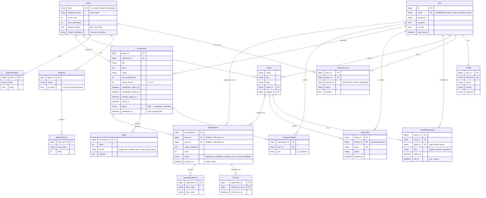
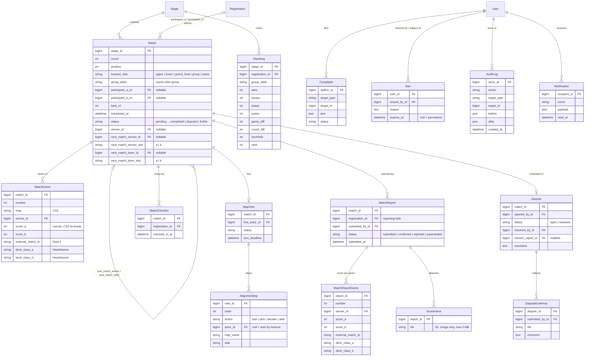
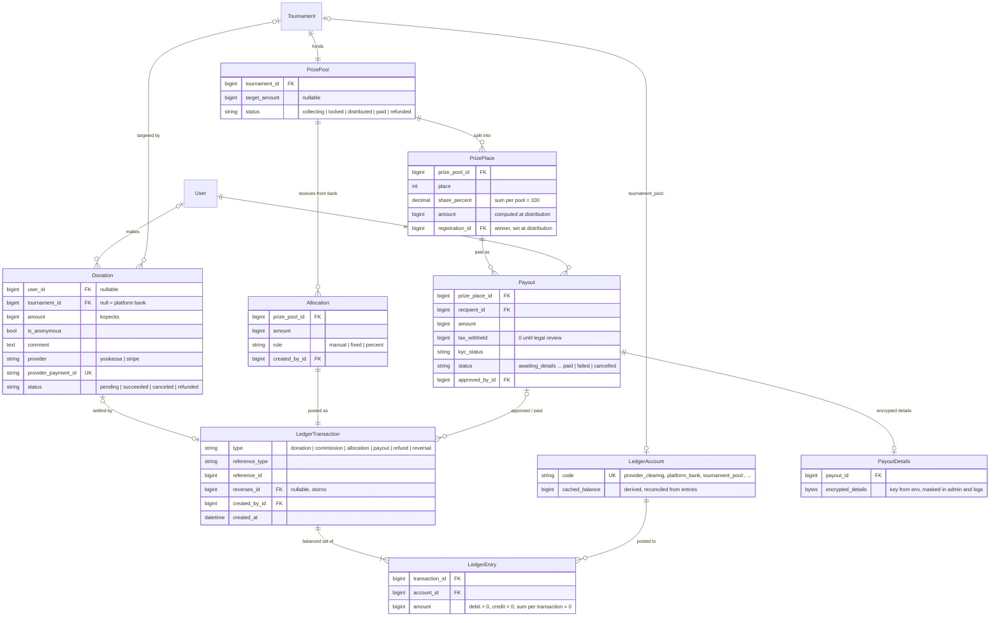

# Модель данных (ERD)

Схема разбита на три диаграммы по доменам. Поля — минимальный набор из `CLAUDE.md` (раздел 5) плюс служебные. `id` (bigint) и `created_at`/`updated_at` подразумеваются у всех таблиц и показаны только там, где важны для логики. Все суммы в деньгах хранятся в копейках (`bigint`), валюта одна — RUB, все даты — в UTC.

## 1. Пользователи, дисциплины, команды, турниры

Ключевые ограничения:
- `GameAccount`: `UNIQUE(game, external_id)`.
- `TeamMembership`: денормализованное `game_id` и частичный уникальный индекс `(user, game) WHERE left_at IS NULL` — одна активная команда игрока в дисциплине; один активный капитан в команде.
- `Team`: `UNIQUE(game, lower(name))`, `UNIQUE(game, lower(tag))`.
- `Registration`: `CHECK ((team_id IS NULL) <> (user_id IS NULL))`; `UNIQUE(tournament, team)` и `UNIQUE(tournament, user)`.
- `Stage`: `UNIQUE(tournament, order)`.
- `HearthstoneDeck`: `UNIQUE(registration, hero_class)`.

## 2. Матчи, результаты, модерация, уведомления

Ключевые ограничения:
- `Match`: `UNIQUE(stage, bracket_side, round, position)`; `next_match_*_slot IN ('a', 'b')`.
- `MatchGame`: `UNIQUE(match, number)`.
- `MatchReport`: одна активная (`submitted`) запись на сторону матча.
- `Standing`: `UNIQUE(stage, registration)`.

## 3. Деньги: донаты, журнал, призы, выплаты

Ключевые ограничения:
- `LedgerEntry` неизменяемы (нет UPDATE/DELETE на уровне сервиса; исправление — сторно через `reverses_id`). Сумма `amount` в рамках `LedgerTransaction` = 0.
- Балансы считаются как `SUM(LedgerEntry.amount)` по счёту; `cached_balance` — только кэш, сверяемый с журналом.
- `Donation.provider_payment_id` уникален — основа идемпотентности вебхуков.
- `PrizePlace`: `UNIQUE(prize_pool, place)`.

Открытые вопросы и принятые решения ведутся в `docs/decisions.md`.
